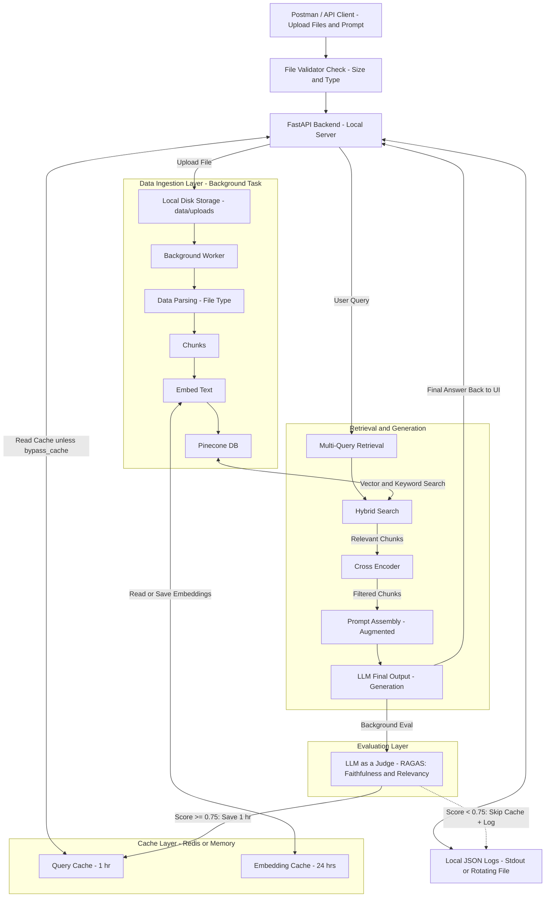

# RAG Pipeline (Local)

Local Retrieval-Augmented Generation (RAG) backend built with **FastAPI**, **Pinecone** (Hybrid Search), **Redis** (Query + Embedding Cache, with in-memory TTL fallback), and **LLM-as-a-Judge** (Faithfulness & Relevancy evaluation).

---

## Architecture Flow



### Flow Summary

1. **Entry & Validation (`app/api/`, `app/ingestion/validator.py`)**
   - Uploaded files pass size and file-type validation before being saved locally.
   - `FastAPI` routes upload requests to the **Data Ingestion Layer** and questions to **Retrieval & Generation**, writing structured JSON logs locally.
2. **Data Ingestion Layer (`app/ingestion/`)**
   - Files save to `./data/uploads` via `LocalDocumentStorage`.
   - FastAPI triggers `ingest_local_document` in the background to parse documents by file type, split into overlapping chunks, generate embeddings (using **24 hr Embedding Cache**), upsert vectors to **Pinecone DB**, and bump the namespace corpus version so stale answers invalidate automatically.
3. **Retrieval & Generation (`app/retrieval/`, `app/generation/`)**
   - Checks **Query Cache (1 hr)** first unless `bypass_cache=true`.
   - On cache miss: expands the question (**Multi-Query Retrieval**), runs **Hybrid Search** against **Pinecone DB**, reranks with a **Cross Encoder**, assembles an augmented prompt, and returns the final cited answer immediately.
4. **Evaluation Layer (`app/evaluation/judge.py`)**
   - Runs **LLM-as-a-Judge** (RAGAS-style **Faithfulness** and **Relevancy** scoring) asynchronously after replying to the user.
   - Only answers scoring `>= 0.75` (`EVAL_CACHE_MIN_SCORE`) are saved to **Query Cache (1 hr)**; low-scoring answers are skipped and logged.

---

## Project Structure

```text
rag-pipeline/
├── app/
│   ├── main.py                  # FastAPI entrypoint, lifespan, local JSON logging
│   ├── config.py                # Typed Pydantic settings (.env)
│   ├── logging_utils.py         # Structured JSON stdout & rotating file logger
│   ├── contracts/               # Centralized Pydantic schemas (API, ingestion, retrieval, eval)
│   ├── api/
│   │   ├── routes_upload.py     # POST /api/v1/upload
│   │   └── routes_query.py      # POST /api/v1/query
│   ├── ingestion/
│   │   ├── validator.py         # File size & type validator
│   │   ├── storage.py           # Local filesystem storage (data/uploads)
│   │   ├── parser.py            # Extract text by file type (pdf, txt, md, docx)
│   │   ├── chunker.py           # Overlapping text splitter
│   │   ├── embedder.py          # Embedding generator + 24h Redis/memory cache
│   │   └── worker.py            # Local background & CLI ingestion runner
│   ├── retrieval/
│   │   ├── multi_query.py       # Query expansion
│   │   ├── vector_store.py      # Pinecone hybrid upsert & search
│   │   ├── reranker.py          # Cross-encoder reranker
│   │   └── pipeline.py          # End-to-end RAG orchestrator
│   ├── generation/
│   │   ├── prompt_assembler.py  # Grounded prompt builder with citations
│   │   └── llm_client.py        # LLM chat completion client
│   ├── cache/
│   │   ├── in_memory_cache.py   # Local TTL fallback & dev memory cache
│   │   └── redis_cache.py       # Redis Query (1h) & Embedding (24h) cache
│   └── evaluation/
│       └── judge.py             # LLM-as-a-Judge (Faithfulness & Relevancy)
├── tests/                       # Pytest suite (unit + FastAPI integration tests)
├── .env.example
├── requirements.txt
└── pyproject.toml
```

---

## Quickstart (Local Machine)

### 1. Create Virtual Environment & Install Dependencies

```bash
python3 -m venv .venv
source .venv/bin/activate
pip install -r requirements.txt
```

### 2. Configure Environment

```bash
cp .env.example .env
# Fill in OPENAI_API_KEY, PINECONE_API_KEY, and REDIS_URL (or use REDIS_URL=memory://)
```

### 3. Run the FastAPI Server

```bash
uvicorn app.main:app --reload --port 8000
```

### 4. Optional: Ingest a Single Local File via CLI

```bash
python -m app.ingestion.worker ./sample.pdf default
```

### 5. Run Tests

```bash
pytest
```

---

## API Endpoints (Postman Ready — No UI Required)

| Method | Path | Body Type | Description |
| :--- | :--- | :--- | :--- |
| `GET` | `/health` | — | Service health check |
| `POST` | `/api/v1/ask` | `form-data` | **Single-step Postman route**: attach `files` (optional, 1 or many) + `prompt`, ingests files immediately, and returns the RAG answer |
| `POST` | `/api/v1/upload` | `form-data` | Upload 1 or multiple files (`file` or `files`) to `./data/uploads` and ingest (set `sync=true` to wait for completion) |
| `POST` | `/api/v1/query` | `raw JSON` | Send `{"prompt": "..."}` (or `{"query": "..."}`), checks 1h cache (unless `bypass_cache=true`), runs RAG + async Judge |

### Testing in Postman

1. **Upload Files + Prompt in One Request (`POST http://127.0.0.1:8000/api/v1/ask`)**
   - Body → **form-data**:
     - `files` (Type: **File**) → select one or more `.pdf`, `.txt`, `.md`, or `.docx` files
     - `prompt` (Type: **Text**) → your question
     - `namespace` (Type: **Text**, optional) → e.g. `default`
2. **Upload Files Separately (`POST http://127.0.0.1:8000/api/v1/upload`)**
   - Body → **form-data**: `files` (Type: **File**, multiple allowed) or `file` (Type: **File**), optional `sync` = `true`
3. **Ask a Prompt Against Indexed Docs (`POST http://127.0.0.1:8000/api/v1/query`)**
   - Body → **raw → JSON**:
     ```json
     {
       "prompt": "Summarize the uploaded document",
       "namespace": "default",
       "bypass_cache": false
     }
     ```
